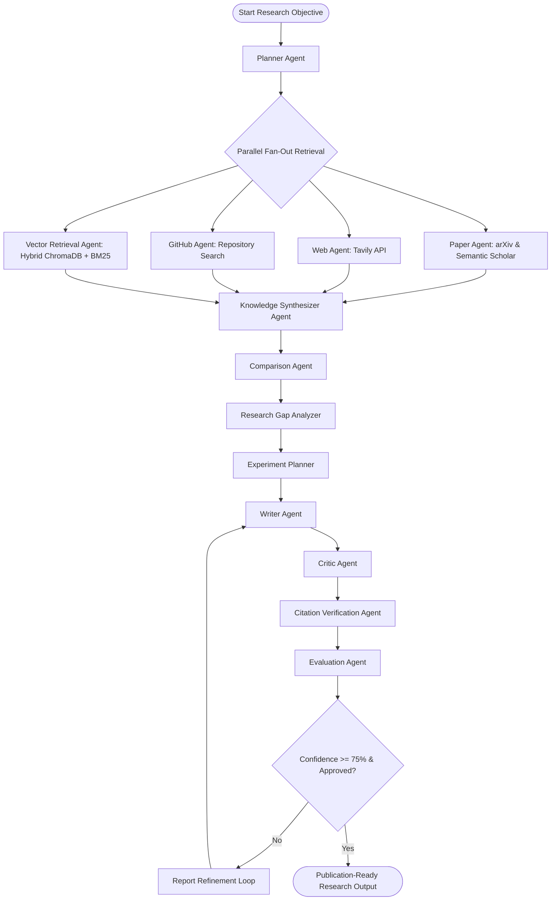

# ResearchMind AI: An Autonomous Multi-Agent AI Research Platform

[](https://python.org)
[](https://github.com/langchain-ai/langgraph)
[](https://fastapi.tiangolo.com)
[](https://nextjs.org)
[](LICENSE)

**ResearchMind AI** is an enterprise-grade autonomous AI research platform designed to execute end-to-end scientific and engineering research workflows. Instead of acting as a standard conversational chatbot, ResearchMind AI operates like a team of specialized AI research scientists.

---

## 🌟 Key Highlights & Engineering Features

- **Advanced LangGraph Workflows**: Orchestrates 13 independent specialized sub-agents with parallel fan-out execution, state machine graph compilation, and conditional critique refinement loops.
- **Parallel Multi-Source Retrieval**: Integrates **arXiv API**, **Semantic Scholar API**, **Tavily Web Search**, **GitHub REST API**, and local user document vector search.
- **Hybrid Dense + Lexical RAG**: Combines vector embeddings (**ChromaDB / Qdrant**) with **BM25 keyword search** and Reciprocal Rank Fusion.
- **Multi-Format Document Ingestion**: Ingests **PDF, DOCX, TXT, MD, CSV, HTML, PPTX** with boundary-aware paragraph text chunking.
- **Method Matrix & Research Gap Analysis**: Automatically constructs comparative matrices across competing techniques, identifies open research gaps, and designs step-by-step empirical A/B experiments.
- **Publication-Quality Long-Form Reports**: Generates structured Markdown research papers with executive summaries, problem statements, key findings, and verifiable citations.
- **RAGAS Evaluation & Telemetry Benchmark**: Computes quantitative **Faithfulness**, **Relevance**, **Grounding**, and **Confidence** scores on every research run.
- **Modern Next.js 14 Dashboard**: Real-time multi-agent execution timeline, live node stream, knowledge base manager, metrics telemetry dashboard, and interactive architecture visualization.

---

## 🏗️ Multi-Agent Architecture



---

## 💻 Tech Stack

- **Core & Orchestration**: Python 3.12, LangGraph, LangChain Core, Pydantic v2
- **Backend API**: FastAPI, Uvicorn, Pydantic Settings, Loguru, Rich
- **Retrieval & Vector Search**: ChromaDB / Qdrant, Rank-BM25, PyPDF, Python-Docx, Python-PPTX
- **APIs & Models**: OpenAI (GPT-4o/4.1), Groq (Llama 3.3 70B), Google Gemini, Tavily API, arXiv API, Semantic Scholar API, GitHub REST API
- **Frontend App**: Next.js 14 (App Router), TypeScript, Tailwind CSS, Lucide Icons, Framer Motion, React Markdown
- **DevOps & Testing**: Docker, Docker Compose, Pytest, Pytest-Asyncio, Ruff, Black, Mypy, GitHub Actions

---

## 🚀 Quickstart Guide

### Prerequisites
- Python 3.12+
- Node.js v18+ & npm
- Git

### 1. Clone & Set Up Backend

```bash
cd backend
python -m venv venv
# On Windows PowerShell:
.\venv\Scripts\Activate.ps1
# On Linux/macOS:
source venv/bin/activate

pip install -r requirements.txt
cp .env.example .env
```

### 2. Run Backend Server & Test Suite

```bash
# Run automated pytest suite
pytest

# Start FastAPI development server
uvicorn app.main:app --reload --port 8000
```

FastAPI Swagger API docs will be available at [http://localhost:8000/docs](http://localhost:8000/docs).

### 3. Set Up & Launch Frontend

```bash
cd ../frontend
npm install
npm run dev
```

The Next.js research workspace will be available at [http://localhost:3000](http://localhost:3000).

---

## 🐳 Docker Deployment

To spin up the full production stack including Qdrant, Redis, FastAPI Backend, and Next.js Frontend:

```bash
docker-compose up --build -d
```

---

## 📄 License

Distributed under the MIT License. See `LICENSE` for details.
